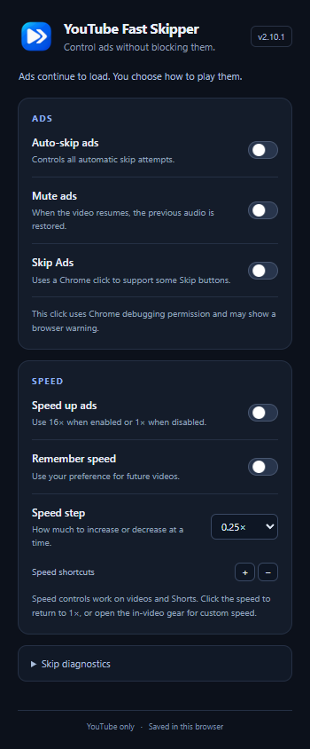

<p align="center">
  
</p>

<h1 align="center">YouTube Fast Skipper</h1>

<p align="center"><strong>An alternative to ad blockers: control ads directly in the player.</strong></p>

A Chrome extension for managing ads and playback speed on YouTube. No account,
server, or runtime dependencies. Install manually with Manifest V3.

## A different approach to ads

**YouTube Fast Skipper is not a traditional ad blocker.** It lets ads load and
provides playback controls: mute them, optionally speed them up, and activate
the Skip button when it becomes available. It does not intercept advertising
requests or use blocklists.

The aim is to make viewing more comfortable while allowing channels' ads to
continue loading. This does not establish that creator revenue is preserved:
billing varies by ad format and campaign. With cost-per-view ads, for example,
Google considers watch time or interaction. We therefore do not promise zero
impact on monetization when skipping or speeding up ads.
[How video ad billing works](https://support.google.com/google-ads/answer/2375464?hl=en).

## Features

- Activates the **Skip** button when it is available and enabled.
- Mutes ads and restores the previous mute state without changing the volume.
- Lets you choose between **16×** ad playback and normal **1×** playback.
- Restores your preferred content speed after each ad.
- Controls playback from **0.25× to 16×**, with shortcuts and saved preferences.
- Supports **YouTube Shorts**, with controls that follow the active Short as you scroll.
- Offers settings in the Chrome toolbar popup and the gear inside the video.
- Includes a copyable diagnostic report to help investigate skipping issues.

The extension does not block ads from loading or unlock Skip buttons early.
Changes to the YouTube player may require extension updates.

## Settings panel



Local preview with the panel expanded. In Chrome, the popup scrolls to show all options.

## Installation

Requires **Chrome 120 or later**. You do not need Node.js to use the extension.

1. Download the source using GitHub's **Code → Download ZIP**, or download the extension ZIP from [Releases](https://github.com/MatheusOps/youtube-fast-skipper/releases/latest).
2. Extract the ZIP to a permanent folder.
3. Open `chrome://extensions` and enable **Developer mode**.
4. Select **Load unpacked** and choose the folder containing `manifest.json`.
5. Confirm Chrome's requested permissions and refresh the YouTube page.

To update, replace the files in the same folder, click **Reload** for the
extension, and refresh your YouTube tabs. Keep only one copy enabled.
If you are updating the former Video Turbo extension, use its existing folder
to preserve the extension's identity and saved preferences.

## Settings

| Option | Behavior |
| --- | --- |
| Auto-skip ads | Enables or disables all automatic skip attempts. |
| Skip Ads | Uses a browser-generated click for buttons that ignore script-generated clicks. Requires Auto-skip ads. |
| Mute ads | Keeps ads muted and restores the previous mute state afterward. |
| Speed up ads | On: 16× during ads. Off: 1×. Your preferred content speed is preserved. |
| Remember speed | Saves your preferred playback speed for future videos. |
| Speed step | Sets the increment used by the buttons and keyboard shortcuts. |

Ad options are enabled by default. Saved choices, including disabled options,
are respected after updates.

In the video panel, `<<` and `>>` adjust speed. Clicking the speed value resets
it to 1×. The gear includes a custom speed field. During ads, these adjustments
set the speed to restore when content resumes. Use `+` or `=` to increase speed
and `-` to decrease it; shortcuts are ignored in text fields. The panel follows
the visibility of YouTube's native progress bar on regular videos.

## YouTube Shorts

Open a Short on `www.youtube.com/shorts/`. The speed controls appear on the
active video even when the regular YouTube progress bar is unavailable. Use
`<<`, `>>`, the custom speed field in the gear menu, or the `+` / `-` shortcuts
to adjust playback from **0.25× to 16×**. Click the speed value to return to 1×.

The selected speed carries over as you scroll to the next Short, including when
YouTube reuses the same video element. Regular videos and Shorts share the same
speed preference; **Remember speed** saves it for future pages. Controls target
the active Short rather than preloaded videos in the feed.

## Why does a debugging banner appear?

**Skip Ads** uses `chrome.debugger` to generate a browser click. This mechanism
was added because some buttons ignore JavaScript-generated events. While it is
in use, Chrome may display a debugging banner. The extension disconnects the
session at the end of each attempt.

The extension cannot hide this warning through normal APIs. Closing the banner
may end the session; cancellation is respected until you toggle the option back
on or reload the extension. Chrome has a developer tooling startup option that
suppresses the banner, but it depends on how the browser is launched, rather
than a setting distributed with the extension.

To stop using this mechanism, disable **Skip Ads**. Script-generated clicks are
still available when **Auto-skip ads** is on, but may not work for some ads.
Muting, playback speed, and the other settings remain independent.

References: [Debugger API](https://developer.chrome.com/docs/extensions/reference/api/debugger)
and [Chrome tooling options](https://github.com/GoogleChrome/chrome-launcher/blob/main/docs/chrome-flags-for-tools.md).

## Permissions and privacy

| Permission | Purpose |
| --- | --- |
| `storage` | Save settings locally in this browser profile. |
| `debugger` | Send the browser click to the Skip button. This is a broad permission; the code enforces the restrictions below. |
| `https://www.youtube.com/*` | Run on YouTube and verify the tab URL before clicking. |

The worker checks the sender, main frame, URL, active tab, focused window,
ad state, visible and enabled target, unobstructed center, and retry interval.
It does not keep debugging sessions attached between attempts.

The extension does not send data to servers, include telemetry, or use cookies
or browsing history. Diagnostics stay in tab memory unless you copy and share
them. They contain status, version, and candidate click target details, without
the page URL. npm dependencies are only used for tests and are not loaded by
the extension.

It works in the main frame of `www.youtube.com`, not the mobile app or videos
embedded on other sites. To use it in Incognito, allow the extension to run
there in Chrome's extension settings.

## Development and tests

Requires **Node.js 22.12+** (24 recommended) and npm. ZIP packaging requires Python 3.9+.

```sh
npm ci --ignore-scripts
npm run check
npm test
npx playwright install chromium
npm run test:browser
python scripts/package.py
```

The installable ZIP is written to `dist/youtube-fast-skipper-2.10.1.zip`.
Packaging uses an explicit file list to keep tests, dependencies, and personal
files out of the installable package. No build step is needed to run the extension.
`dist/youtube-fast-skipper-source-2.10.1.zip` contains the source and documentation
for sharing on GitHub, without installed dependencies or local Git history.

Tests cover audio restoration, button selection, retries, worker checks,
preferences, Shorts navigation, and interfaces. The unit suites use simulated
DOM and browser APIs. The browser suite uses isolated Chromium pages served by
local fixtures to check layout, visible controls, and actual clicks. It does not
open YouTube or reuse your browser profile. To use an existing Chrome executable
instead of downloading Chromium, set the `CHROME_PATH` environment variable.
Passing tests alone does not prove the outcome on real YouTube pages. After player
changes, manually verify skipping, audio, and playback speed on YouTube.

GitHub Actions runs validation and generates ZIP artifacts on pushes and pull
requests. See [CONTRIBUTING.md](CONTRIBUTING.md) for contribution and release instructions.

## License

[MIT](LICENSE). An independent project, not affiliated with YouTube or Google.
